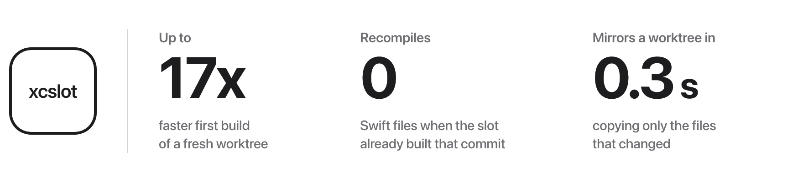

<p align="center">
  
</p>

<h1 align="center">xcslot</h1>

<p align="center">Warm Xcode build slots for parallel coding agents.</p>

<p align="center">
  <a href="#install">
    
  </a>
  <a href="https://github.com/ertembiyik/xcslot/releases/latest">
    
  </a>
  <a href="https://github.com/ertembiyik/xcslot/actions/workflows/ci.yml">
    
  </a>
  <a href="LICENSE">
    
  </a>
</p>

Every agent gets its own git worktree, and every fresh worktree builds from scratch: Xcode reuses build data
only at the same path with the same file timestamps. `xcslot` keeps a few build slots at fixed paths, mirrors
your worktree into a free one and runs your build there. The first build of a new worktree becomes an
incremental one.

```sh
xcslot xcodebuild -scheme App -destination 'generic/platform=iOS Simulator' build
```

Put `xcslot` in front of the command you already run. Every argument passes through, and the output and exit
code come back unchanged, with paths pointing at your worktree.

<p align="center">
  <picture>
    <source media="(prefers-color-scheme: dark)" srcset=".github/assets/stats-dark.png" />
    
  </picture>
</p>

<p align="center">
  <i>Measured on <a href="https://github.com/Dimillian/IceCubesApp">IceCubesApp</a> (1,510 Swift files): 85 s cold, 4.8 s through a warm slot. <a href="docs/benchmarks.md">How it was measured</a>.</i>
</p>

## Install

```sh
brew install ertembiyik/tap/xcslot
```

macOS, Apple silicon and Intel. Then give your coding agents the skill that teaches them to build through
xcslot:

```sh
npx skills add ertembiyik/xcslot -g
```

Without the skills CLI, xcslot writes the skill into a skills folder itself:

```sh
xcslot skill install --dir ~/.claude/skills
```

`xcslot doctor` checks that everything it needs is in place.

## Quick start

In a worktree, run your usual build with `xcslot` in front. A new slot's first build is a cold one:

```sh
xcslot xcodebuild -scheme App build
```

Run the same command in another worktree that was never built. It takes seconds, because nothing needs
recompiling, and prints two lines of its own on stderr:

```console
$ xcslot xcodebuild -scheme IceCubesApp build
xcslot: slot 1: synced 0 changed files in 0.3s
** BUILD SUCCEEDED **
xcslot: slot 1: xcodebuild exited 0 after 4.8s; products: ~/Library/Developer/xcslot/IceCubesApp-accf84b1/1/DerivedData/Build/Products (valid until the next build in slot 1); log: ~/Library/Developer/xcslot/IceCubesApp-accf84b1/logs/2026-11-24T04-56-12.256Z-slot1.log
```

| Command                                                 | What it does                                           |
| ------------------------------------------------------- | ------------------------------------------------------ |
| `xcslot run -- swift test`                              | Any other build command, in the slot's copy of the cwd |
| `xcslot xcodebuild --products-to out -scheme App build` | Keeps the built app, with debug symbols                |
| `xcslot status`                                         | Who holds which slot right now                         |

## For coding agents

xcslot is built to be driven by an agent: it never prompts, it says who it is waiting for, and its own
failures are one JSON object with a code, a hint and a safe next command. The skill from
[Install](#install) is four rules and fits in a screen. Without skills, one line in `AGENTS.md` does it:

```md
Build and test through xcslot: `xcslot xcodebuild <the usual arguments>`. `xcslot commands --json` lists the rest.
```

Give each agent its own simulator as well; [Simlock](https://github.com/callstackincubator/simlock) leases
them, and `-destination id=<udid>` passes straight through.

## How it works

- **A slot is a folder that never moves**, with a checkout of your repository and its own DerivedData.
- **Your worktree is mirrored into it.** Only files whose content differs are rewritten, so everything else
  keeps its timestamp and Xcode sees an incremental build.
- **The build runs there, and the results come back**: output with paths rewritten to your worktree, files
  the build wrote (snapshots, `Package.resolved`), and products with debug symbols that still map to your
  sources after the slot moves on.
- **Slots are shared.** A few per repository, with a machine-wide cap on builds at once. A busy slot is
  waited for, and the wait names the holder.

Tuist projects are generated inside the slot; other generators are one entry in `.xcslot.json`. More in
[How it works](docs/how-it-works.md).

## What it does not do

- A new slot's first build is a cold build. Three slots mean up to three cold builds per repository.
- A slot is warm for the tree it built last. A worktree far from that tree rebuilds what differs, as a
  checkout in place would. A one-file edit costs the same as anywhere.
- Build inputs outside the repository (a `../Shared` folder) are not mirrored.
- Xcode's own window does not use slots.
- It adds no build settings and does not turn on Xcode's compilation cache.

## Documentation

[How it works](docs/how-it-works.md) · [Reference](docs/reference.md) ·
[Configuration](docs/configuration.md) · [Benchmarks](docs/benchmarks.md) · [Contributing](AGENTS.md)

## License

MIT. See [LICENSE](LICENSE).
