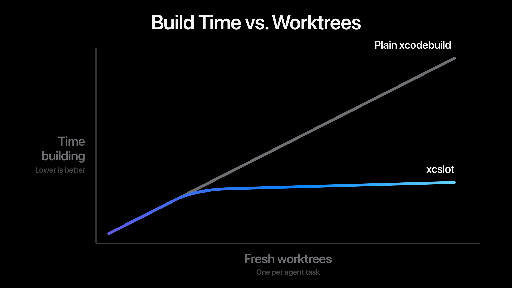

# Benchmarks

What a fresh worktree's first build costs, and what each way of avoiding it buys.



The chart is drawn from the figures below: 85 s for each cold build, 4.8 s for a fresh worktree through a warm
slot, three slots, each building cold once.

## Setup

- **Project:** [IceCubesApp](https://github.com/Dimillian/IceCubesApp) at commit `9efcb16`, a plain
  `.xcodeproj` with 13 local Swift packages plus remote ones. 1,510 Swift files compile, with dependencies.
- **Machine:** a 12-core Apple silicon Mac, Xcode 27.0, with other work running.
- **Command:** `xcodebuild -project IceCubesApp.xcodeproj -scheme IceCubesApp -destination 'generic/platform=iOS Simulator' CODE_SIGNING_ALLOWED=NO COMPILER_INDEX_STORE_ENABLE=NO ONLY_ACTIVE_ARCH=YES build`
- **Measured:** wall time of the command, one run each unless a range is given. "Swift files" counts the
  files the build compiled.

## A fresh worktree's first build

| How the worktree gets its build data              | First build        | Swift files compiled            | A one-file edit after it |
| ------------------------------------------------- | ------------------ | ------------------------------- | ------------------------ |
| Its own DerivedData (cold)                        | 85 s (82 to 107 s) | 1,510                           | 35 s                     |
| DerivedData cloned in from another worktree       | 107 s              | 1,510                           | 42 s                     |
| Xcode's compilation cache shared across worktrees | 43 s               | 0 misses, every task still runs | 32 s                     |
| **Through a warm slot**                           | **4.8 s**          | **0**                           | 33 s                     |

- The cold figure is the first of four runs; the four ranged from 82 to 107 s.
- The slot figure is the median of three fresh worktrees (4.7, 4.8 and 19 s), plus 0.2 s to mirror the
  worktree. The 19 s run was the first after the slot's own cold build.
- Cloning DerivedData is an APFS clone of the whole folder (5 s) into a worktree at another path. Nothing is
  reused, because the build data names the old path.
- The compilation cache was populated by one build and read by a worktree at another path, with prefix
  mapping on. Every lookup hit, and the build still ran every task.
- The two combine: with that cache already filled, a new slot's first build took 42.6 s instead of 85 s.

A one-file edit costs the same everywhere, because the edited module has dependents that recompile.

## A slot that moves to another commit

A slot is warm for the tree it built last. Moved to a commit ten commits away it rebuilt 1,284 files in 62 s;
`git checkout` of the same commit in place, in a normal worktree, rebuilt the same 1,284 files in 66 s. A slot
is no worse than building in place and no better.

## Again, with the released binary

Repeated on 2026-11-24 with xcslot 0.1.3 from Homebrew while other builds kept the machine at a load average
near 20, so every figure is slower:

| Build                                   | Time             | Compile jobs |
| --------------------------------------- | ---------------- | ------------ |
| Cold, its own DerivedData               | 186 s            | 3,794        |
| A new slot's first build (also cold)    | 199 s            | 3,794        |
| Three more builds, from three worktrees | 14, 15 and 5.3 s | 0            |

## Other project shapes

- **A generated Tuist project.** A fresh worktree built with no compile jobs in 1.1 s on a small sample.
  After one source file was added, the project regenerated, 10 of its 11 generated files kept their
  timestamps, and only the new file compiled.
- **Swift packages.** `swift build` reuses its `.build` folder the same way. On `swift-argument-parser` a
  fresh worktree took 6.9 s with `.build` cloned in and 0.9 s at a fixed path with timestamps kept. One small
  package; not a broad claim.

## Measure your own project

Make two fresh worktrees of the same commit:

```sh
git worktree add --detach ../bench-a HEAD
git worktree add --detach ../bench-b HEAD
```

In the first, time a cold build for reference, then a new slot's first build, which is cold too:

```sh
cd ../bench-a
time xcodebuild -scheme App -derivedDataPath ./DerivedData build
time xcslot xcodebuild -scheme App build
```

In the second, time the build through the now-warm slot. This is the number that matters:

```sh
cd ../bench-b
time xcslot xcodebuild -scheme App build
```

To count compiled files, pipe the build into `grep -c '^SwiftCompile '`; a warm slot prints 0.
